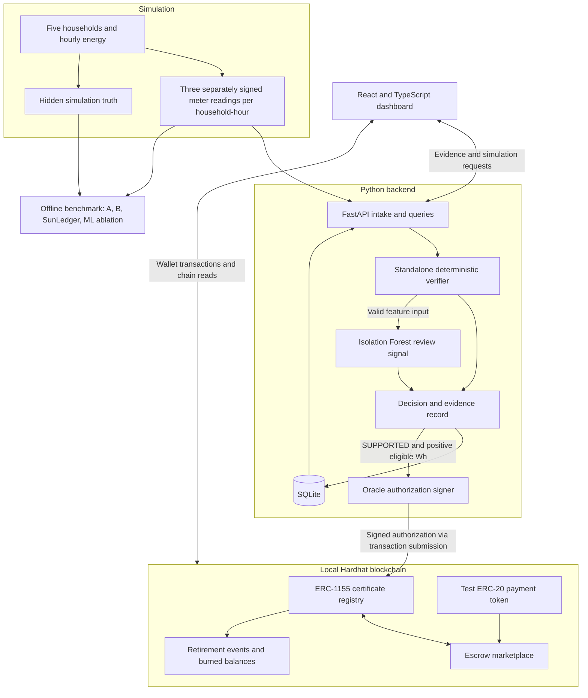

# SunLedger Architecture

Date: 2026-10-16 · Track: Renewable Energy & Energy Trading

This document describes the original six-component SunLedger MVP. It is a proposed design, not a description of implemented software. The user chose SunLedger over the exploratory pivots. The [build plan](plans/2026-10-16-2128-feat-sunledger-mvp-plan.md) owns requirements, milestones, and acceptance gates; this document explains the design and shared interfaces. The [pivot report](ideation/2026-10-16-sunledger-pivots-ideation.html) is historical exploration and is not build scope.

## 1. Purpose and boundaries

SunLedger demonstrates five simulated households exchanging certificates backed by evidence of solar surplus. Its core question is whether uncertainty-aware verification reduces unsupported issuance compared with signature-only and nominal physics checks, and how much legitimate surplus is withheld in return.

All energy flows, payments, and household identities are simulated. Certificates are traceability instruments inside SunLedger, not official renewable-energy certificates. A purchase transfers an allocation, not physical electricity. No carbon savings, external environmental entitlement, or real-grid safety is established.

Use a modular monolith: a Python process with isolated simulator, verifier, ML, persistence, API, and oracle modules; a local Hardhat node; and a React frontend. No microservices, message broker, cloud deployment, or public testnet is needed.

## 2. Architecture map



The benchmark receives both observations and hidden truth. The verifier, ML features, oracle, and dashboard evidence path receive observations only. Hidden truth may appear in a separately labeled evaluation view after decisions are made.

## 3. Component responsibilities

| Component | Owns | Does not establish |
|---|---|---|
| Simulator | Seeded energy profiles, noise, signed observations, labeled attacks | Real household behavior or meter accuracy |
| Verifier | Signatures, registration, intervals, replay, physical checks, reconciled eligible Wh | Truth when evidence sources collude or violate assumed bounds |
| ML module | Feature extraction, anomaly score and review threshold | Issuance authority or proof of fraud |
| Oracle | Signing a supported authorization | Independent on-chain physics verification |
| Registry | Authorized one-time issuance, balances, transfers, retirement | Accuracy of the oracle's evidence judgment |
| Marketplace | Listed inventory, price, atomic payment and transfer | Physical electricity delivery |
| FastAPI / SQLite | Evidence lifecycle, query interface, transaction references | On-chain ownership or successful transaction execution |
| React | Evidence explanations, neighborhood, trading, retirement, attack controls | Permission to bypass contract rules |

The deterministic verification function has no API, database, blockchain, or model-training dependencies. Inject registrations, policy, clock, and replay context. The orchestration layer persists replay constraints transactionally.

## 4. Energy model and uncertainty

### Hourly simplification

For each UTC-aligned half-open interval `[start, end)`, exactly one hour long, model generation `G`, consumption `C`, and export `E` in integer Wh. No batteries, imports from neighbors, or other generation sources exist.

The model defines `E = max(0, G - C)` at the hourly aggregate. Real gross hourly export can differ when import and export alternate within the hour. That behavior is deliberately not simulated; real deployment would need subinterval data or explicit import accounting. Do not present the equation as universal meter physics.

The generation envelope uses registered panel capacity and a documented deterministic daylight/irradiance profile. A kW capacity must be multiplied by interval hours before comparing with Wh. The simulator's physical envelope and meter-error policy are versioned inputs, not hidden truth available to verification.

### Bound reconciliation

For policy-approved measurement intervals `[Glo, Ghi]`, `[Clo, Chi]`, `[Elo, Ehi]`:

```text
balance_lower = max(0, Glo - Chi)
balance_upper = max(0, Ghi - Clo)
reconciled_lower = max(balance_lower, Elo)
reconciled_upper = min(balance_upper, Ehi)
```

An empty intersection is UNVERIFIED. Otherwise the lower bound is the eligible quantity, optionally capped by a smaller requested quantity. Measurements and bounds use integer Wh so no floating-point amount enters a signature or contract; unit conversions round bounds outward and certifiable amounts downward.

Example: generation `5,000 ± 100 Wh`, consumption `3,000 ± 100 Wh`, export `2,000 ± 100 Wh` gives balance `[1,800, 2,200]`, intersection `[1,900, 2,100]`, and eligibility `1,900 Wh`.

Bounds come from the registered simulation policy. A meter cannot authorize its own arbitrary accuracy, panel capacity, or widened tolerance. Malformed bounds are rejected; missing required evidence is unverified. A reading whose uncertainty interval cannot intersect the physical generation envelope is rejected. Small nighttime noise within approved bounds is not treated as definite impossible generation.

### Verdict order

| Priority | Condition | Verdict / effect |
|---|---|---|
| 1 | Invalid signature, identity, interval, nonnegative quantity, policy bounds, duplicate observation, or definite physical violation | REJECTED; no authorization |
| 2 | Required evidence missing, inconsistent reconciliation, or otherwise valid data flagged by ML | UNVERIFIED; no authorization |
| 3 | Complete consistent evidence, no review flag | SUPPORTED; authorize only a positive eligible amount |

A nominal request for `2,000 Wh` is not rejected solely because only `1,900 Wh` is conservative: the authorized amount is reduced. A request above the reconciled upper bound is an unsupported excess claim and is REJECTED. Contract calls seeking a quantity different from the exact signed authorization fail independently.

SUPPORTED with zero eligible Wh is a valid result with no mint. ML cannot turn a deterministic failure into SUPPORTED or increase the eligible quantity. The MVP provides explanations for UNVERIFIED results but no manual override workflow.

## 5. Shared records

Fields below define conceptual data contracts to freeze in Phase 0. JSON field names and cryptographic fixtures must match across Python, TypeScript, and Solidity before chain integration.

| Record | Fields |
|---|---|
| Household | `household_id`, producer wallet, registered panel capacity, physical-profile version |
| Meter registration | `meter_id`, household, role (`generation`, `consumption`, `export`), public signing address, valid interval, allowed uncertainty policy |
| Signed reading | schema version, simulation namespace, household, meter, role, UTC interval, measured Wh, lower/upper Wh, policy version, reading ID, signature |
| Verification request | request ID, household, interval, reading references, optional requested Wh |
| Verification result | verdict, reason codes, eligible Wh, reconciled bounds, deterministic check results, anomaly score/flag, policy/model versions, evidence hash |
| Authorization | issuance ID, household ID, interval start/end, recipient, exact authorized Wh, evidence hash, policy version, expiry, signature |
| Listing | listing ID, seller, certificate/token ID, remaining Wh, immutable unit price |
| Chain operation | operation type, issuance/listing ID, chain ID, registry address, transaction hash, receipt state, block reference |
| Benchmark scenario | seed, family, observations, hidden truth and labels, policy/model versions; truth kept separate from verifier inputs |

Verification verdict, issuance state, listing state, and retirement history are separate concepts. Do not encode all of them into a single certificate status: a batch can be partially held, escrowed, sold, and retired at once.

### Identity and signatures

- Use distinct registered meter keys and a separate oracle key. Separate keys simulate source identity; they do not prove independence of physical instruments.
- Use standard Ethereum-compatible signing libraries. Meter messages use their own typed domain and a simulation namespace; issuance uses a separate EIP-712 domain bound to chain ID and registry address. Changing role, interval, Wh, or bounds invalidates the signature.
- Derive `issuance_id` from a fixed application tag, household ID, and interval with a specified ABI encoding. The registry recomputes this ID from signed fields. The identifier must not change with request ID, meter replacement, model version, or evidence hash.
- One canonical hourly allocation per household is allowed in a registry deployment. Do not allow overlapping custom intervals. No top-up mint or correction/reissuance workflow in the MVP.
- Canonical evidence serialization uses a fixed versioned JSON schema, integer values, sorted keys and fixed reading order, UTF-8, and documented separators; hash the bytes with Keccak-256. Store those exact bytes for reproduction. Do not hash the hash itself or depend on arbitrary JSON formatting.

EIP-712 provides domain separation but explicitly does not provide replay prevention; SunLedger needs independent reading uniqueness and consumed-issuance checks. See [EIP-712](https://eips.ethereum.org/EIPS/eip-712).

## 6. Sequence and failure recovery

```mermaid
sequenceDiagram
    participant S as Simulator
    participant B as Backend
    participant O as Oracle
    participant W as Producer wallet
    participant R as Registry
    participant M as Marketplace
    participant C as Consumer wallet
    S->>B: Signed readings
    B->>B: Validate, reconcile, score, persist evidence
    alt Positive SUPPORTED result
        B->>O: Eligible quantity and evidence commitment
        O-->>B: Signed authorization
        B-->>W: Authorization and evidence card
        W->>R: Submit issuance transaction
        R-->>W: Successful receipt and issuance event
        W->>M: Approve and escrow listing
        C->>M: Approve payment and buy Wh
        M->>C: Atomic certificate transfer
        C->>R: Retire held Wh
        R-->>C: Burn and retirement event
    else Rejected, unverified, or zero eligible
        B-->>W: Explain result; no issuance
    end
```

The browser submits issuance, listing, purchase, and retirement through local test wallets. Automated integration tests drive the same calls directly. The backend signs authorizations but does not need a funded transaction relayer or arbitrary wallet custody.

### Persistence and replay

SQLite uses uniqueness constraints for reading ID and `(namespace, meter, role, start, end)`, plus issuance identity and evidence hash references. Validation and recording of a new reading batch occur in one database transaction; concurrent duplicate ingestion cannot both succeed. A repeated signed reading is reported as REJECTED/replay. Retrying a query for an existing result is a read, not a new ingestion or new issuance.

The demonstration API can ingest incomplete evidence and produce an immutable UNVERIFIED result. Reuse already stored observations by reference to retrieve explanations; do not resubmit them. Automatic correction or evidence-completion workflows are excluded. Fresh demonstrations use new household-hour identities or an explicitly reset local dataset.

### Issuance lifecycle

```mermaid
stateDiagram-v2
    [*] --> Evaluated
    Evaluated --> NoAuthorization: Rejected / Unverified / zero Wh
    Evaluated --> Authorized: Supported positive Wh
    Authorized --> Pending: Wallet submits
    Pending --> Confirmed: Successful receipt + matching event
    Pending --> Failed: Reverted receipt
    Authorized --> Expired: Deadline passes
    Failed --> Pending: Same still-valid authorization; check chain first
    Confirmed --> [*]
```



After a timeout or restart, query the transaction receipt and registry before suggesting resubmission. API success does not mean issuance succeeded. A consumed authorization cannot create more certificates even if the UI lost the receipt. No authorization renewal or administrative mint bypass is needed; expired demo cases can be re-run on a new interval.

After a local chain reset, redeploy and reseed chain-linked state coherently. Generate fresh local identities/domain salt and discard old authorizations; chain ID and deterministic contract address can repeat. Benchmark scenario namespaces remain separate from the interactive demo namespace.

## 7. Contract boundaries and invariants

### Certificate registry

One ERC-1155 token ID corresponds to one issuance ID. One unit is one Wh. Mint the complete exact signed amount once, then permit partial transfers and retirements. Persist a lifetime consumed flag; zero circulating supply after retirement must never reopen issuance.

Use OpenZeppelin EIP-712 and ECDSA utilities with the registry's immutable trusted oracle identity. No externally callable unrestricted mint method. The authorization binds all economically relevant fields, nonzero recipient, positive quantity and expiry. Mark issuance consumed before ERC-1155 receiver callbacks; failed transactions roll back the mark.

Retire through a dedicated holder-authorized method that burns held Wh and emits holder, token ID, amount and evidence-linked reference. Do not inherit a separate public burn path that bypasses the required retirement record. The holder cannot retire units still in marketplace escrow.

Per batch: lifetime issued Wh equals current balances, including escrow, plus lifetime retired Wh. Retired balances cannot be transferred or reminted. See [OpenZeppelin ERC-1155](https://docs.openzeppelin.com/contracts/5.x/api/token/erc1155).

### Fixed-price marketplace

Listings escrow certificates at creation. Seller may cancel and recover unsold Wh. Purchases can take part of the remaining listing. Use one seeded fixed unit price shared by the MVP; no auction or dynamic price feature. Payment base units are defined per Wh so `cost = quantity_Wh × unit_price` is exact; dashboard can display a per-kWh equivalent.

Use the configured standard test ERC-20 with OpenZeppelin SafeERC20. Reject zero or excess quantities, invalid listings, wrong token addresses, and insufficient approvals. Decrease remaining inventory before external interactions, protect state-changing functions from reentrancy, and transfer payment and certificates within one transaction. Failure of either leg rolls back both. No fees, royalties, fee-on-transfer payment tokens, or nonstandard ERC-20 integrations. See [OpenZeppelin ERC-20 utilities](https://docs.openzeppelin.com/contracts/5.x/api/token/erc20).

## 8. API, frontend and local operation

Planned API surfaces, not existing endpoints:

| Surface | Purpose |
|---|---|
| `GET /health` | Backend and configured chain readiness |
| `GET /households` | Five profiles and latest observation summaries |
| `POST /simulation/run` | Generate a bounded seeded demo interval set |
| `POST /verification` | Ingest/evaluate one signed household-hour batch |
| `GET /verification/{id}` | Stored result without re-ingestion |
| `GET /evidence/{hash}` | Exact committed evidence plus readable explanation |
| `GET /authorizations/{issuance_id}` | Existing authorization for a supported batch |
| `POST /demo/attacks/{scenario}` | Run one allowlisted simulated attack |

There is no API route that mints without the registry checking a signed authorization. Local demo mutation routes bind to loopback and are not a production authentication design. Benchmark runs offline, not through unrestricted web requests.

React has Neighborhood, Marketplace, Verification Console and Security Demo views. Query evidence through FastAPI; query holdings, issuance, listings and retirement events from the configured chain. Cache only for presentation. Display pending, confirmed and failed transactions separately, including wrong-network/wallet rejection states. A retirement log remains visible after balances are burned.

Keep backend and oracle keys out of frontend bundles. Local dev wallet selection is a demo feature, not a production account system. Treat all bundled local test credentials as disposable, never as production secrets.

## 9. ML and evaluation design

Train a lightweight Isolation Forest on separate legitimate simulated history. Candidate features: generation/capacity ratio, consumption, export, hour encoded cyclically, and normalized reconciliation residuals. Do not use hidden truth, attack labels, or a known attack switch as features. Validate the threshold on separate data and freeze it before final testing. Persist seed, features, preprocessing, training split and model version. See [Isolation Forest documentation](https://scikit-learn.org/stable/modules/generated/sklearn.ensemble.IsolationForest.html).

| Evaluation arm | Policy |
|---|---|
| A: signature-only | Shared identity/interval/replay validation; issue requested Wh or nominal export when no explicit request |
| B: standard physics | A plus nonnegative values, nominal capacity/daylight and nominal balance/export consistency with fixed documented tolerances; authorize nominal feasible surplus, capped by request |
| SunLedger without ML | Same authentication plus deterministic bounded reconciliation |
| SunLedger full | Previous arm plus anomaly review gate |

All arms receive the same observed fields and scenario order. Freeze precise B tolerances before evaluation; B is a disclosed research baseline, not a reproduction of any company. Use per-arm replay state and explicit scenario groups for duplicates; otherwise independent scenarios must not contaminate one another.

Generate at least 500 held-out scenario groups, covering clean observations, valid boundary/noise cases, legitimate unusual patterns, inflated claims, missing/conflicting evidence, replay, invalid signatures, impossible generation, and coordinated false readings. Record scenario counts and seeds; correlated meter errors and out-of-bound errors must be labeled separately from the model's promised assumptions.

Measure unsupported Wh `max(0, issued - true_eligible_export)` and legitimate Wh withheld `max(0, true_eligible_export - issued)` per unique issuance, then aggregate. Replay scenarios count cumulative issuance against one unique household-hour truth budget, not a new export budget for every duplicate. Rejected/reviewed results issue zero.

Report invalid-claim detection by verdict and family, false rejection and review on legitimate cases, and supported issuance on invalid cases. Integrity-only attacks with physically correct values need separate labels from physically false claims. Time verifier computation separately from chain mining, API latency and model training; report deterministic and full pipeline distributions on the same hardware. Publish actual results even when benefits are small or absent.

## 10. Proposed repository layout

```text
backend/
  domain/          # schemas, registrations, policies, reason codes
  simulator/       # truth generation, noisy observations, attack fixtures
  verification/    # pure checks and reconciliation
  ml/              # features, training, scoring
  oracle/          # typed authorizations and signatures
  storage/         # SQLite transactions and evidence persistence
  api/             # FastAPI routes and coordination
  tests/
contracts/
  contracts/       # registry, marketplace, test payment token
  scripts/         # local deployment and seed data
  test/
frontend/
  src/             # views, evidence client, wallet/contract adapters
  tests/
benchmarks/        # scenario generator, comparison runner, result reports
datasets/          # optional documented historical input
docs/
  architecture.md
  plans/
  ideation/        # historical alternatives, not implementation scope
```

## 11. Remaining implementation details

Exact compatible dependency versions, fixture seeds, daylight profile parameters, baseline B tolerances, model threshold and visual styling are to be selected and recorded in the relevant phase before final evaluation. These details do not authorize changing product behavior. Start without an external historical dataset; adding one only informs simulated profiles and requires a license/source record.

Trust limitations remain even after successful tests: a compromised oracle can authorize false evidence, coordinated meters can agree on lies, a local chain can be reset, and a commitment hash does not guarantee data availability. These limitations belong in the README and demo.
