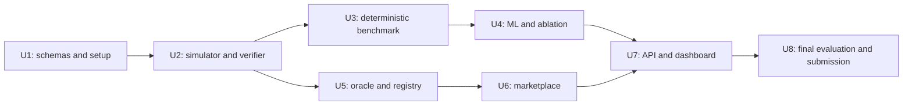

# SunLedger MVP - Plan

## Goal Capsule

**Objective:** demonstrate a complete five-household simulated solar-certificate lifecycle with explainable evidence-bounded issuance, enforced accounting, and a reproducible evaluation of its benefits and trade-offs.

**Means:** Python simulation/verification/ML, a local Solidity registry and marketplace, and a React dashboard. The [architecture document](../architecture.md) defines component boundaries, shared records and protocol mechanics.

**Authority:** the user's Final MVP Scope and subsequent choice to keep SunLedger govern product scope. The Product Contract below captures those constraints. This plan governs sequencing and acceptance; the architecture owns interface detail. Resolve contradictions before coding rather than silently expanding scope. The pivot report is not a source of build requirements.

**Execution boundary:** this request authorizes documentation only. Implementation begins only after the user agrees to the architecture and first milestone. Later milestones are delivered and checked incrementally, not generated as one unreviewed application. No commit, push, PR, deployment or publication is authorized by this document.

**Target:** MVP complete October 24, 2026; video/submission October 25 ahead of the user's stated October 26, 1 AM Sydney cutoff. The official deadline and timezone must be checked before submission. All schedule dates below use Australia/Sydney time and are targets, not measured estimates.

## Product Contract

### Problem Frame

A signed meter reading establishes its signing identity, not physical accuracy. A token ledger can prevent certain duplicate allocations without establishing that the underlying surplus existed. A credible prototype must expose the evidence and assumptions behind issuance and quantify incorrect issuance alongside the legitimate surplus it withholds.

### Summary

Build the original SunLedger marketplace: simulate signed observations, verify bounded surplus, flag anomalies, authorize certificates, sell them with test tokens, and retire them. Compare signature-only, nominal physics, and full SunLedger verification using reproducible held-out scenarios.

### Key Decisions

- Keep the original SunLedger outcome over the proposed alternatives. (session-settled: user-directed — chosen over ReserveGuard, CoolAccess and FlexLab: the user explicitly chose to continue SunLedger.) Governs R1–R14.
- Preserve the final MVP scope and exclude stretch goals. (session-settled: user-directed — chosen over adding differentiating features: the user specified “I want to build this only.”) Governs R14.

### Actors

- A1. Producer: one of five simulated households; receives authorized certificates and lists them.
- A2. Consumer: another household; purchases and retires certificates.
- A3. Demo operator: runs seeded simulation, attacks and evaluation with local test identities.
- A4. Oracle: trusted application signer; authorizes supported positive quantities.

### Requirements

#### Evidence and verification

- R1. Simulate five registered households with hourly generation, consumption and independently simulated export readings, separately signed by their registered meter identities.
- R2. Verify registration, signatures, interval validity, reading uniqueness, physical generation limits and energy consistency under documented no-battery assumptions.
- R3. Compute a conservative certifiable quantity from approved uncertainty bounds and independent evidence, with SUPPORTED, REJECTED and UNVERIFIED outcomes and explicit reasons.
- R4. Add a lightweight Isolation Forest review signal that cannot override hard failures or increase certifiable quantity; measure its contribution separately.

#### Certificate lifecycle and marketplace

- R5. Only a positive SUPPORTED result may receive a domain-bound oracle authorization linked to evidence; API and frontend success cannot bypass that authorization.
- R6. ERC-1155 registry enforces integer-Wh quantities, authorization limits, unique household-hour issuance, replay protection and transfers even when called directly.
- R7. Holders can permanently retire certificates through burning with inspectable retirement events; retirement cannot permit reuse or reminting.
- R8. Producers list certified quantities and consumers buy at a fixed simulated price using test ERC-20 tokens, with payment and certificate transfer atomic.

#### Interface, evaluation and delivery

- R9. React provides five-household overview, verification console, evidence cards, marketplace, ownership/retirement information and security demonstrations.
- R10. Demonstrate duplicate signed readings, impossible nighttime generation, inflated surplus, conflicting/missing evidence, unauthorized minting, excess/duplicate issuance, oracle replay and attempted retired-unit reuse.
- R11. Compare the three required verification systems on at least 500 reproducible simulated evaluation scenario groups and run a SunLedger-without-ML ablation.
- R12. Report unsupported energy certified, legitimate energy withheld, invalid-claim detection, false rejection/review rates and processing time with explicit denominators, assumptions and seeds; never invent gains.
- R13. Deliver passing invariant tests, reproducible local setup, architecture/README, public repository submission materials and a 3–5 minute demo video.
- R14. Remain simulation-only; exclude real financial/grid integrations, batteries, forecasting, dynamic prices, public-chain deployment, advanced emissions analytics, ZK proofs and official renewable-certificate claims.

### Key Flows

- F1. R1–R5: simulated truth → noisy signed readings → deterministic checks → anomaly review → persisted evidence → positive authorization or explained non-issuance.
- F2. R5–R8: wallet submits authorization → confirmed issuance → escrowed listing → purchase receipt → consumer balance → permanent retirement event.
- F3. R10–R12: identical seeded observed scenarios → isolated per-system evaluation → compare with hidden truth → reproducible reports and ML ablation.

### Acceptance Examples

- AE1. Covers R2–R5: `5,000 ± 100 Wh` generation, `3,000 ± 100 Wh` consumption and `2,000 ± 100 Wh` export yield `[1,900, 2,100] Wh`; a normal case authorizes `1,900 Wh`, not `2,000`.
- AE2. Covers R3–R5: inconsistent independent intervals or a missing meter yield UNVERIFIED and no authorization; invalid signatures and definite impossible generation yield REJECTED.
- AE3. Covers R3, R6: a nominal 2,000 Wh request in AE1 is reduced to 1,900; an unsupported request above 2,100 Wh is rejected; a direct mint requesting more than the signed amount reverts.
- AE4. Covers R6–R8: Alice issues 1,900 Wh, escrows 1,000 and sells it to Bob; Bob retires 1,000; Alice retains 900 and Bob cannot transfer retired units.
- AE5. Covers R2, R6, R10: duplicate signed observations cannot create another verification allocation; reusing an authorization fails even after all originally issued units are retired.
- AE6. Covers R4, R12: an unusual but valid reading may be reviewed; its withheld quantity and review outcome appear in the legitimate-case metrics rather than being labeled a successful fraud detection.
- AE7. Covers R5, R9: transaction submission can succeed while the chain transaction reverts; the dashboard shows failure and does not increase holdings.

### Scope Boundaries

The six components in R1–R9 and their research/security evidence are the full MVP. R14 exclusions are not implied future milestones. Historical data is optional and must not delay the synthetic baseline. The previous pivot document remains an archive only. No manual review override, certificate correction/recall product, production identity system, paid services, or multi-oracle protocol is included.

## Planning Contract

### Repository baseline

At planning time the repository contains only the prior HTML ideation report and the documentation created by this task. All application directories, dependency manifests, scripts and test files below are proposed additions. No builds, contract deployments, tests or benchmark measurements have been run.

### Key Technical Decisions

- KTD1. Use one modular Python backend, one local Hardhat node and one React application. Keep pure verification independent of transport, storage, ML training and blockchain clients. This makes the first milestone useful before any contracts or UI exist.
- KTD2. Freeze integer-Wh records, canonical interval identities and cross-language signature fixtures before integration. The architecture's Sections 4–5 own interval, uncertainty, claim and ID semantics. The hourly aggregate model deliberately excludes within-hour import/export alternation.
- KTD3. Use EIP-712 domain separation for issuance plus explicit consumed IDs and expiry checks. [EIP-712](https://eips.ethereum.org/EIPS/eip-712) does not itself prevent replay; reading uniqueness and on-chain consumption are independent controls. Use maintained Ethereum signing libraries, not handwritten cryptography.
- KTD4. Mint the exact authorized batch once and use dedicated retirement that always emits the required event. OpenZeppelin ERC-1155 is the foundation, not an authorization policy; [its API](https://docs.openzeppelin.com/contracts/5.x/api/token/erc1155) informs callback/reentrancy checks.
- KTD5. Escrow certificate inventory for listings and protect atomic purchases with checks-effects-interactions, reentrancy protection and [SafeERC20](https://docs.openzeppelin.com/contracts/5.x/api/token/erc20). This avoids stale listings caused by sellers moving advertised stock.
- KTD6. Separate replay/evidence state in SQLite from authoritative ownership and settlement on-chain. Wallet transactions require successful receipts and matching events; retry by checking existing chain state. A reset reseeds identities and domain salt so old authorizations do not become valid again.
- KTD7. Define baseline policies and scenario truth before evaluating ML. Train and calibrate Isolation Forest on separate legitimate history and validation data; freeze it before held-out testing. [Scikit-learn's model](https://scikit-learn.org/stable/modules/generated/sklearn.ensemble.IsolationForest.html) is an anomaly detector, not a truth verifier.
- KTD8. Resolve and pin mutually compatible Python, Node, Solidity, Hardhat, ethers and OpenZeppelin versions in U1. [Hardhat's current setup guide](https://hardhat.org/docs/getting-started) is the compatibility reference; do not assume an old configuration or mix incompatible plugin generations. No dependency is installed by this planning task.

### High-Level Technical Design

The [architecture](../architecture.md) owns the detailed component map, signed records, verification rule order, issuance state machine, lifecycle sequence and API surfaces. This dependency sketch shows the build order rather than duplicating those protocols.

### Assumptions and implementation-owned calibration

- The user has approved the product scope, not every proposed implementation detail. Review this design and approve the U1–U2 milestone before execution.
- Hourly boundaries are UTC internally; Sydney dates are presentation/scheduling only.
- Uncertainty limits are registration/policy inputs; reported accuracy cannot be chosen arbitrarily by an untrusted reading.
- The application runs on loopback with disposable demo accounts. Production authentication and key custody are excluded.
- U1 selects reproducible default seeds, capacity/daylight parameters and exact serialization vectors. U3 records fixed baseline-B tolerances and scenario proportions. U4 selects model parameters/threshold on validation data before the final evaluation set is opened.
- The oracle and modeled independent evidence remain trusted. A consistent coordinated false-reading case may pass; document it rather than claiming universal tamper detection.

### Delivery phases and target dates

| Phase | Unit | Target Sydney dates | Reviewable result / exit gate |
|---|---|---|---|
| 0. Freeze interfaces and local setup | U1 | Oct 16–17 | Schemas, policies, signatures and compatible local tools recorded |
| 1. Prove the core standalone | U2 | Oct 17–18 | Five-household signed data → explainable conservative verdicts; first implementation milestone |
| 2. Establish research baseline | U3 | Oct 18 | Deterministic benchmark and labeled truth model run reproducibly |
| 3. Add and evaluate AI | U4 | Oct 19 | Model/review policy and separately measured contribution |
| 4. Enforce issuance and retirement | U5 | Oct 19–20 | Cross-language authorization and contract invariants proven |
| 5. Complete the trade | U6 | Oct 20–21 | One household sells, another buys and retires using test funds |
| 6. Integrate and explain | U7 | Oct 21–23 | Dashboard drives the complete lifecycle and attack demonstrations |
| 7. Freeze and submit | U8 | Oct 23–25 | Final tests/results by Oct 24; video and submission Oct 25 |

Dates overlap only where dependencies allow. Start contracts after deterministic verifier/schema agreement while ML evaluation proceeds. Work sequentially unless additional development capacity is available. This is an aggressive schedule from an empty repository; re-estimate after U2. If time slips, simplify visual polish and omit optional historical data before changing any MVP acceptance requirement. Escalate a genuine scope trade-off to the user.

## Implementation Units

### U1. Freeze the shared interface and reproducible environment

**Goal:** establish compatible tools and records that every component can implement without guessing. Covers R1–R3, R5–R6, R14; follows KTD1–KTD3, KTD8. Dependencies: user approval to begin.

**Proposed files:** `backend/pyproject.toml`, backend lockfile selected with the package manager, `backend/domain/schemas.py`, `backend/domain/policy.py`, `backend/domain/identities.py`, `backend/tests/fixtures/signing-vectors.json`, `backend/tests/test_schemas.py`, `contracts/package.json`, `contracts/package-lock.json`, `contracts/hardhat.config.ts`, `frontend/package.json`, `frontend/package-lock.json`, `.gitignore`, `.env.example`, and updates to `docs/architecture.md`.

**Approach:** select version-compatible tools; define record types, reason codes, reading namespace, interval policy, configured meter bounds and canonical evidence encoding. Publish numeric fixtures for AE1, a zero-eligible case, reading signatures and issuance hashing. Document how demo identities are regenerated on reset. Do not build full features in scaffolding.

**Test scenarios:** reject negative Wh, unordered bounds, wrong duration and nonaligned intervals; verify a fixed signed reading and fail verification after changing role, quantity or interval; ensure serialization yields stable evidence bytes/hash. Backend schema tests carry these checks. Contract-side signature recovery comes in U5.

**Exit gate:** documented pinned setup and shared fixture formats; clean local dependency/runtime smoke checks after implementation. The detailed signing fixture is reviewed before dependent modules proceed.

### U2. Build the simulator and standalone deterministic verifier

**Goal:** prove SunLedger's core without UI, ML or blockchain. Covers R1–R3, R10, AE1–AE3, AE5. Follows KTD1–KTD2. Dependency: U1.

**Proposed files:** `backend/simulator/profiles.py`, `backend/simulator/readings.py`, `backend/simulator/attacks.py`, `backend/verification/checks.py`, `backend/verification/reconcile.py`, `backend/verification/engine.py`, `backend/tests/test_simulator.py`, `backend/tests/test_verifier.py`.

**Approach:** generate hidden hourly truth first, derive independent noisy observations second, then sign them. Use injectable policy/clock/replay context. Return structured check evidence and reason codes, not only a Boolean. Demonstrate physical impossibility separately from inconsistent independent evidence.

**Execution note:** begin with the AE1 reconciliation and rejection/review boundary cases before integrating the simulator; these are the most consequential invariants.

**Test scenarios:** five registered households and three meter roles; fixed-seed repeatability; bounded legitimate noise; AE1 exactly 1,900 Wh; empty intersection; absent export; zero export; impossible generation outside approved tolerances; permissible nighttime noise; inflated request above upper bound versus legitimate nominal request reduced to lower bound; invalid signatures; wrong registration/interval; duplicate observations; valid unusual readings; coordinated consistent false evidence documented as a limitation.

**Exit gate / first milestone:** a standalone command or Python entry point produces signed data and readable evidence-backed verdicts with meaningful tests passing. Review that result with the user before moving into the remaining system.

### U3. Establish deterministic baselines and benchmark truth

**Goal:** measure verification trade-offs before adding ML. Covers R11–R12 and F3. Follows KTD7. Dependency: U2.

**Proposed files:** `benchmarks/scenarios.py`, `benchmarks/baselines.py`, `benchmarks/metrics.py`, `benchmarks/run.py`, `benchmarks/tests/test_metrics.py`, `benchmarks/tests/test_scenarios.py`, `benchmarks/README.md`.

**Approach:** freeze scenario families, counts, seeds and baseline B tolerances. Generate at least 500 held-out groups separate from training/calibration. Execute A, B and deterministic SunLedger with separate replay states and the same observed inputs. Keep hidden truth behind the evaluator boundary. Save raw outcomes and aggregate reports with configuration versions.

**Test scenarios:** a known 2,000 Wh truth issued as 4,000 yields 2,000 unsupported Wh; issuance of 1,900 yields 100 withheld Wh; review/rejection issues zero; duplicate submissions share one truth budget and reveal repeated issuance; physical-truth and integrity labels remain separate; changing scenario order does not contaminate independent groups; fixed seeds reproduce outcomes.

**Exit gate:** deterministic report reruns with identical quantities/verdicts, correct metric fixtures, declared denominators and no invented improvements. Processing times may vary and must be treated separately from deterministic output equality.

### U4. Add anomaly review and evaluate its contribution

**Goal:** integrate lightweight ML without weakening deterministic verification. Covers R4, R11–R12, AE6. Follows KTD7. Dependency: U3.

**Proposed files:** `backend/ml/features.py`, `backend/ml/train.py`, `backend/ml/scoring.py`, `backend/tests/test_ml_gate.py`, model configuration/metadata, and extensions to `benchmarks/run.py`.

**Approach:** train Isolation Forest on separate legitimate simulated history. Select a threshold on validation data and freeze it before held-out evaluation. Score only structurally valid complete inputs. A flagged case becomes UNVERIFIED; deterministic rejection keeps precedence. Persist feature/preprocessing versions and add the full SunLedger arm alongside its no-ML ablation.

**Test scenarios:** hard violations cannot become SUPPORTED; an injected anomaly score drives the documented review gate; missing inputs cannot become invented measurements; inference is repeatable for the same frozen model; legitimate unusual readings are represented in review metrics. Use the actual held-out evaluation to report detector effectiveness rather than writing a test that assumes every chosen attack must be detected.

**Exit gate:** all required arms produce a reproducible measured comparison and an honest account of the ML contribution, including false review and any absent benefit.

### U5. Implement oracle authorization and certificate registry

**Goal:** enforce issuance and retirement independently of the frontend/backend routes. Covers R5–R7, R10, AE3–AE5. Follows KTD2–KTD4, KTD6. Dependency: U2 and U1 signing schemas; use deterministic fixtures until U4 is ready.

**Proposed files:** `backend/oracle/attestations.py`, `backend/tests/test_oracle.py`, `contracts/contracts/SunLedgerRegistry.sol`, `contracts/scripts/deploy.ts`, `contracts/test/Registry.test.ts`, shared signing fixtures.

**Approach:** authorize only positive SUPPORTED results. Registry recomputes canonical issuance identity, enforces aligned hourly interval and one-time exact issuance, then records evidence commitment and events. Implement dedicated holder retirement. Seed only local test identities and persist deployment addresses/chain ID for frontend configuration.

**Test scenarios:** Python signature accepted by Solidity; wrong signer, domain, contract, chain, recipient, quantity, evidence hash or expired authorization fails; duplicate issuance and oracle replay fail; altered interval cannot produce another allocation; nonaligned or overlapping custom intervals fail; valid transfers; unauthorized/overbalance retirement fails; burn emits retirement; retirement cannot reopen issuance; receiver callback cannot reenter issuance; lifetime issued equals held plus retired.

**Exit gate:** direct contract tests prove invariant enforcement without UI. Cross-language signing fixture and evidence hash match exactly.

### U6. Build escrow marketplace and test payment token

**Goal:** complete a sale and retirement between households. Covers R8 and AE4. Follows KTD5. Dependency: U5.

**Proposed files:** `contracts/contracts/SunLedgerMarketplace.sol`, `contracts/contracts/TestPaymentToken.sol`, `contracts/scripts/seed.ts`, `contracts/test/Marketplace.test.ts`, `contracts/test/Lifecycle.test.ts`.

**Approach:** use approved registry certificates and configured payment token only; escrow at listing, fixed global unit price, partial purchase, seller cancellation. Demonstration token supply is seeded through local deployment tooling; it is not a real financial product. Record listing/purchase/cancellation events for inspection.

**Test scenarios:** exact inventory escrow; partial sale and remaining inventory; cancellation returns only unsold Wh; insufficient allowance/balance and failed token transfer roll back; unauthorized cancellation fails; zero/excess quantities fail; multiple purchases cannot oversell; external callbacks cannot reenter purchase/cancel; buyer can retire acquired units; already escrowed or retired quantities cannot be listed again.

**Exit gate:** scripted local lifecycle reproduces AE4 with exact payment and certificate balances and all contract checks passing.

### U7. Integrate persistence, API and React dashboard

**Goal:** make the evidence-to-retirement flow understandable and usable. Covers R5, R9–R10, F1–F2, AE7. Follows KTD1, KTD6. Dependencies: U4 and U6; simple UI scaffolding may begin after U1 schemas.

**Proposed files:** `backend/storage/repository.py`, `backend/storage/schema.sql`, `backend/api/app.py`, `backend/api/routes.py`, `backend/tests/test_api.py`, `backend/tests/test_replay_concurrency.py`, `frontend/src/views/Neighborhood.tsx`, `VerificationConsole.tsx`, `Marketplace.tsx`, `SecurityDemo.tsx`, `frontend/src/lib/api.ts`, `contracts.ts`, `frontend/tests/lifecycle.spec.ts`.

**Approach:** add transactional observation uniqueness, immutable evidence retrieval and authorization lookup. Frontend uses API for evidence, local wallets for writes and chain reads/receipts for ownership. Display local simulation limits and the meaning of retirement. Include wrong-network, denied-wallet, pending and reverted states. Attack actions use bounded allowlisted fixtures, not arbitrary signing/mint access.

**Test scenarios:** concurrent duplicate ingestion accepts at most one allocation; read-only result retrieval does not reissue; missing/conflicting evidence never exposes authorization; committed evidence bytes reproduce hash; simulated contract revert leaves UI holdings unchanged; interrupted transaction reconciles from receipt/registry; scenario reseed separates old deployment state; buyer purchase and retirement visible after refresh; all R10 attack demos have correct explanations.

**Exit gate:** browser demonstration of AE1→AE4 plus required attacks; API/chain failure states remain accurate. Start a minimal browser test harness here rather than testing only mocked component internals.

### U8. Freeze the MVP, reproduce results and prepare submission

**Goal:** deliver a reviewer-reproducible project and truthful presentation. Covers R10–R14. Dependencies: U7.

**Proposed files:** `README.md`, `docs/demo-script.md`, `docs/security-and-assumptions.md`, final benchmark output/configuration under `benchmarks/results/`, `.env.example` refinements and reproducible local setup scripts. These files are planned, not created by this documentation task.

**Approach:** rerun the frozen benchmark, record machine/tool/model versions, complete integration checks, and remove abandoned code. README explains local accounts, setup/reset, evidence assumptions, actual measured trade-offs and certificate limitations. Prepare a 3–5 minute video showing valid issuance, blocked attacks, a purchase, retirement and the benchmark. Verify official submission requirements and deadline before upload.

**Verification:** another clean local setup can reproduce the seeded demo and deterministic benchmark output; raw results support every numerical statement in README/video. No separate unit test is needed for prose/video; evidence is the clean-setup walkthrough, passing suites and artifact consistency review.

**Exit gate:** global Definition of Done satisfied. Keep all six components in the final scope; obtain user agreement if a deadline-driven reduction becomes necessary. Public repository visibility, submission and any publishing are separate authorized actions, not automatically triggered by this plan.

## Verification Contract

The following are proposed command interfaces to establish during implementation; they do not exist yet. Do not report them as passed until run against the implemented project.

| Working directory | Command interface | What it establishes |
|---|---|---|
| `backend/` | `python -m pytest` | Schemas, simulator, verifier, oracle and API invariants |
| repository root | `python -m benchmarks.run --config benchmarks/config/evaluation.json` | Frozen held-out comparison and output metadata; U3 creates the configuration file |
| `contracts/` | `npm test` | Hardhat registry, marketplace and lifecycle tests; U1 establishes script |
| `frontend/` | `npm run build` | Type checking and production bundling; U1 establishes script |
| `frontend/` | `npm run test:e2e` | Browser lifecycle with local backend/chain; U7 establishes harness and script |

Run unit-specific checks at each gate, then integration checks when those dependencies exist. Re-run broader suites when a shared schema, oracle payload, contract invariant or cross-component behavior changes. Documentation-only edits need link/consistency checks, not application tests against an empty repository.

Benchmark outputs record counts per family, seed, all policy tolerances, training/validation/evaluation split, model fingerprint, code revision and runtime environment. Latency excludes training and chain mining and reports sample count plus median/p95 on the same machine. Re-run deterministically on identical inputs; never tune on the final evaluation set. Scenario coverage is descriptive and synthetic, not a measured real-world attack prevalence.

## Risks and Dependencies

| Risk | Consequence and treatment |
|---|---|
| Hourly net-export simplification | Document architecture Section 4 and test only the stated model; don't generalize to real gross export |
| Arbitrary meter uncertainty | Registration-policy bounds are authoritative; reject unsupported self-declared accuracy |
| Compromised oracle or colluding sources | Can authorize unsupported real-world claims; disclose, simulate and measure rather than promise elimination |
| Cross-language hashing/signing mismatch | Block issuance integration until fixed vectors match in U5 |
| Replay or chain reset confusion | Persist uniqueness and consumed IDs; coherent reset with new identities/salt and no stale authorizations |
| ML creates more false review than value | Publish ablation honestly; keep deterministic checks authoritative |
| Synthetic benchmark bias | Separate truth, varied scenario families, held-out data and reported assumptions; optional historical data is supplementary |
| Schedule pressure | Re-estimate after core milestone; avoid stretch scope and keep Oct 25 for submission preparation |

## Definition of Done

- Five households produce signed readings and the verifier calculates justified quantities under recorded assumptions.
- All three verdicts have evidence-backed explanations; only positive SUPPORTED results authorize issuance.
- Isolation Forest is integrated and its contribution evaluated separately.
- Registry and marketplace enforce R5–R8 under direct contract calls, including replay, over-issuance, atomicity and retirement checks.
- A household sells to another, the buyer retires purchased units, and balances/history remain correct after refresh.
- Dashboard and all required security demonstrations work, including legitimate unusual cases and failure-state explanations.
- At least 500 held-out scenario groups produce reproducible three-system metrics and ML ablation with actual measured results.
- Relevant backend, contract, build and browser checks pass; README/setup and reset instructions work from a clean local state.
- Architecture, trust assumptions, benchmark report and 3–5 minute demo are consistent with the implementation.
- Abandoned experiments are removed; real keys, generated local databases and unnecessary build artifacts are not committed.
- The repository/video submission package is ready, with the official cutoff checked before publishing or submission.

## Sources

Product requirements come from the user's Final MVP Scope and subsequent explicit choice to keep SunLedger. Technical references are linked at the decisions they support. The architecture document is the interface reference; no production behavior is claimed by these plans.
